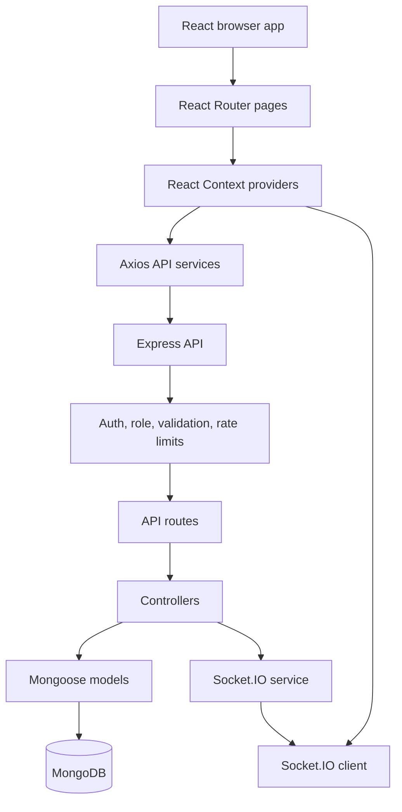
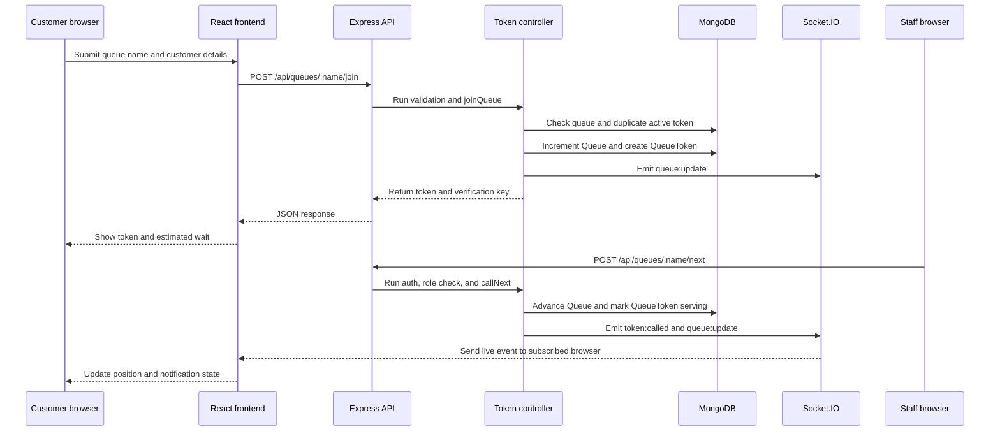
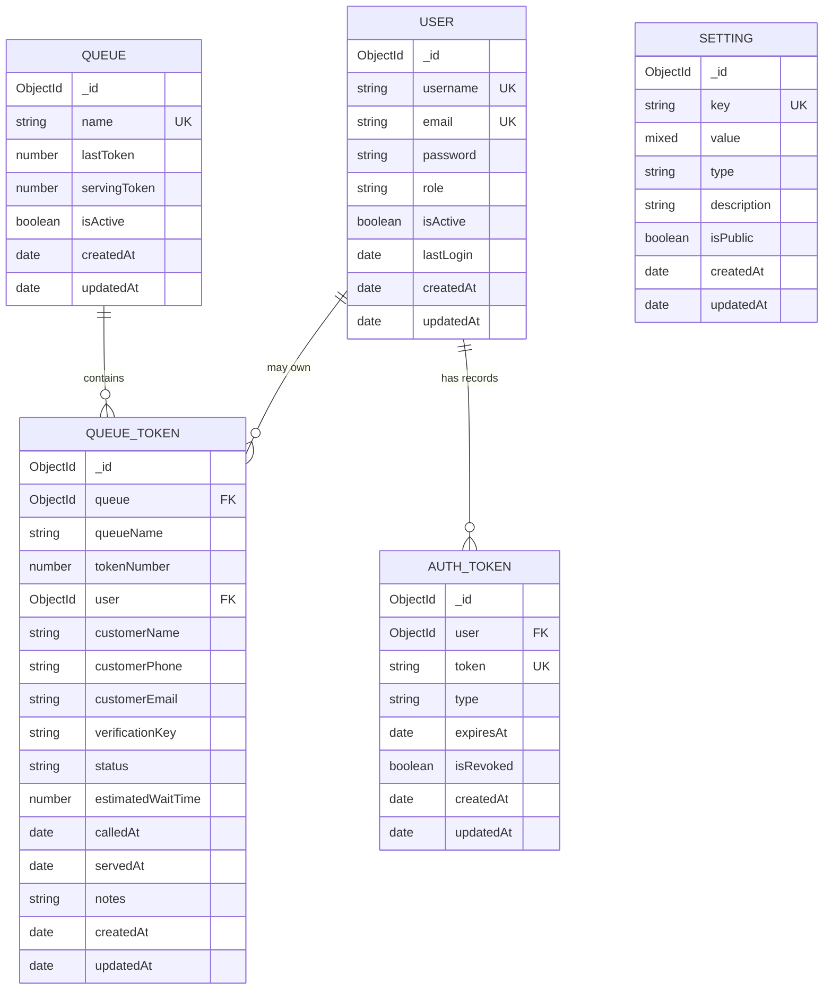

# Smart Queue Management System Architecture

This document explains the project in simple English. It describes the code that is currently in the repository.

## 1. What the Project Does

The Smart Queue Management System lets customers join service queues online and receive a numbered token.
Customers can check their token status and receive live updates when staff move the queue.
Staff manage queue operations, while administrators can create queues and view system counts.

## 2. Technology Stack

| Tool or library     | What it is used for                                                  | Where it is used                                                                              |
| ------------------- | -------------------------------------------------------------------- | --------------------------------------------------------------------------------------------- |
| Node.js             | Runs the server-side JavaScript                                      | `backend/index.js`                                                                            |
| Express             | Creates the HTTP API and middleware pipeline                         | `backend/index.js`, `backend/routes/`, `backend/middleware/`                                  |
| MongoDB             | Stores users, queues, queue tokens, auth-token records, and settings | Accessed through Mongoose models in `backend/models/`                                         |
| Mongoose            | Defines MongoDB schemas and reads/writes database documents          | `backend/models/` and backend controllers                                                     |
| React               | Builds the browser user interface                                    | `frontend/src/`                                                                               |
| Vite                | Runs the frontend development server and creates frontend builds     | `frontend/vite.config.js`, `frontend/package.json`                                            |
| React Router        | Selects the page shown for each browser URL                          | `frontend/src/App.js`                                                                         |
| Material UI         | Provides interface components and themes                             | `frontend/src/components/`, `frontend/src/pages/`, `frontend/src/context/ThemeContext.js`     |
| Axios               | Sends HTTP requests from the frontend to the backend                 | `frontend/src/services/ApiService.js` and other frontend services                             |
| Socket.IO           | Sends real-time queue and token events from the server               | `backend/services/socketService.js`, `frontend/src/context/SocketContext.js`                  |
| JSON Web Token      | Creates and verifies login tokens                                    | `backend/utils/jwt.js`, `backend/controllers/authController.js`, `backend/middleware/auth.js` |
| bcryptjs            | Hashes passwords and compares login passwords                        | `backend/models/User.js`                                                                      |
| express-validator   | Validates request data                                               | `backend/validators/` and route files                                                         |
| Helmet              | Adds HTTP security headers                                           | Backend startup middleware                                                                    |
| CORS                | Controls which frontend origins may call the API                     | Backend startup and `backend/config/index.js`                                                 |
| express-rate-limit  | Limits repeated requests                                             | `backend/middleware/rateLimiter.js` and route files                                           |
| dotenv              | Loads backend environment variables                                  | `backend/config/index.js`                                                                     |
| `@vercel/analytics` | Sends frontend analytics data                                        | `frontend/src/App.js`                                                                         |

The backend rejects MongoDB operator keys in request bodies, query objects, and route parameters. It also uses express-validator for field-level validation and Mongoose schemas for data constraints. No standalone MongoDB sanitization package is mounted.

## 3. Folder and File Structure

### Root

- `README.md`: General project description, features, setup notes, and technical notes.
- `README-academic.md`: Academic project description and presentation-oriented documentation.
- `ARCHITECTURE.md`: This beginner-friendly architecture guide.
- `backend/`: Node.js and Express API server.
- `frontend/`: React and Vite browser application.

### Backend

- `backend/index.js`: Starts Express, connects to MongoDB, creates the HTTP server, attaches Socket.IO, and mounts middleware and routes.
- `backend/package.json`: Backend dependencies and the `npm start` script.
- `backend/config/index.js`: Loads environment variables and provides server, database, CORS, and rate-limit settings.
- `backend/routes/`: Defines API URLs and connects them to middleware and controllers.
- `backend/controllers/`: Contains authentication, queue, token, queue-state, and analytics request logic.
- `backend/models/`: Contains Mongoose schemas and database methods.
- `backend/middleware/`: Authentication, role authorization, validation support, rate limiting, sanitization, and error handling.
- `backend/validators/`: Validation rules for authentication, queues, and tokens.
- `backend/services/socketService.js`: Authenticates Socket.IO connections, manages rooms, and emits events.
- `backend/services/index.js`: Exports backend services.
- `backend/utils/jwt.js`: Signs and verifies JWTs.
- `backend/utils/privacy.js`: Masks customer contact information for some responses.

### Backend Models

- `backend/models/User.js`: User account, password hash, role, active state, and login time.
- `backend/models/Queue.js`: Queue name, last issued token, current serving token, and active state.
- `backend/models/QueueToken.js`: A customer's token, customer details, verification key, status, and timing data.
- `backend/models/Token.js`: A schema for access, refresh, and reset token records with expiry and revocation fields.
- `backend/models/Setting.js`: A generic key/value settings schema; no current controller uses it.
- `backend/models/BaseModel.js`: Shared soft-delete schema methods used by `User`.

### Frontend

- `frontend/index.html`: Vite HTML entry point.
- `frontend/package.json`: Frontend dependencies and `npm start` and `npm run build` scripts.
- `frontend/vite.config.js`: Vite configuration, development port, proxy, and build settings.
- `frontend/src/index.js`: Mounts React and composes the providers.
- `frontend/src/App.js`: Defines lazy-loaded pages and browser routes.
- `frontend/src/index.css`: Global styles.
- `frontend/src/pages/`: Home, login, registration, customer, staff, admin, legal, and error pages.
- `frontend/src/components/common/`: Shared header, footer, loading, errors, route protection, notifications, queue cards, and SEO components.
- `frontend/src/components/customer/`: Customer queue selection, joining, token tracking, and automatic notifications.
- `frontend/src/components/staff/`: Staff queue operation controls.
- `frontend/src/components/admin/`: Queue creation, administrative controls, and analytics dashboard.
- `frontend/src/context/`: React state providers for authentication, queues, sockets, and theme settings.
- `frontend/src/services/`: Axios API wrapper and queue and analytics service functions.
- `frontend/src/hooks/`: Reusable React hooks, including browser notification handling.
- `frontend/src/utils/`: Constants, input/display sanitizing, logging, formatting, and error handling.
- `frontend/public/`: Public static files such as the manifest, robots file, sitemap, and HTML fallback.
- `frontend/build/`: A checked-in frontend build output in this repository.

## 4. High-Level Architecture

The browser uses HTTP for normal requests and Socket.IO for live events. The API routes select middleware and controllers. Controllers use Mongoose models to read and update MongoDB.



## 5. Request Flow

This example shows a customer joining a queue and then receiving a live update after staff call the next token.



## 6. Database Schema

The application uses MongoDB. The following diagram shows the fields and relationships defined by the Mongoose models. `QueueToken.queue` references a `Queue`, and `QueueToken.user` optionally references a `User`.



`Queue.waiting` is a virtual value, not a stored field. It is calculated as `lastToken - servingToken`, with a minimum of zero. The `Setting` model is currently standalone in the application code and has no relationship shown to another model.

## 7. Three Main Features

### Feature 1: Customer Joins a Virtual Queue

1. The customer opens the customer page. The route and page are defined in `frontend/src/App.js` and `frontend/src/pages/CustomerView.jsx`.
2. The page loads available queues through `frontend/src/context/QueueContext.js` and `frontend/src/services/QueueService.js`.
3. `frontend/src/components/customer/CustomerQueuePicker.jsx` selects a queue, and `JoinQueueForm.jsx` collects customer details.
4. The frontend sends `POST /api/queues/:name/join` through the API service.
5. The route applies optional authentication, validation, and token-generation rate limiting in `backend/routes/tokenRoutes.js`.
6. `backend/controllers/tokenController.js` checks the queue and duplicate active entries, increments the queue counter, creates a `QueueToken`, and generates a six-digit verification key.
7. `Queue.js` and `QueueToken.js` save the queue and token data through MongoDB.
8. The response returns the token information to the frontend, which displays it to the customer.

### Feature 2: Customer Tracks a Token and Gets Live Notifications

1. The customer enters a queue name, token number, and verification key in the customer token-tracking interface.
2. The frontend calls `GET /api/queues/:name/token/:tokenNumber` through `frontend/src/services/QueueService.js`.
3. `backend/routes/tokenRoutes.js` validates the token request, and `backend/controllers/tokenController.js` checks the verification key before returning status data.
4. The controller calculates or returns status information such as position, estimated wait, wait time, and service time from `QueueToken` and `Queue` data.
5. `frontend/src/context/SocketContext.js` connects the browser to Socket.IO, and `QueueContext.js` listens for `queue:update` and `token:called` events.
6. `frontend/src/components/customer/TokenStatus.jsx` updates the visible token status.
7. `frontend/src/components/customer/AutoNotificationManager.jsx` and `frontend/src/hooks/useNotification.js` handle browser notifications, in-app notifications, and sound alerts.

### Feature 3: Staff and Admin Manage Queues

1. A user logs in through `frontend/src/pages/Login.jsx`. `AuthContext.js` sends the login request and stores the returned JWT in local storage.
2. `backend/controllers/authController.js` checks the user and creates the JWT. `backend/middleware/auth.js` verifies it on protected requests.
3. `ProtectedRoute.jsx` controls access to the staff and admin pages. `authorize.js` checks the server-side role.
4. `frontend/src/pages/StaffView.jsx` uses `frontend/src/components/staff/QueueControls.jsx` for calling the next token, completing service, abandoning a token, and pausing or resuming a queue.
5. These actions call the queue token and queue state routes in `backend/routes/tokenRoutes.js` and `backend/routes/queueStateRoutes.js`.
6. The controllers update `Queue` and `QueueToken` documents, then emit Socket.IO events so connected browsers can refresh their views.
7. `frontend/src/pages/AdminView.jsx` also uses `CreateQueueForm.jsx`, `AdminQueueControls.jsx`, and `AnalyticsDashboard.jsx`.
8. Admin-only routes let administrators create or delete queues and request `GET /api/analytics/counts`, which is calculated by `analyticsController.js`.

## 8. How to Run the Project

### Requirements

- Node.js, as required by the backend and frontend package manifests.
- A running MongoDB server, unless a different MongoDB connection string is supplied.

### Start the backend

```bash
cd backend
npm install
npm start
```

The backend command runs `node index.js`. The default backend port is `5000`, and the default host is `0.0.0.0`.

### Start the frontend

Open another terminal:

```bash
cd frontend
npm install
npm start
```

Vite is configured to use port `3000`. To create a production frontend build, run:

```bash
npm run build
```

### Environment variables

The backend reads variables through `backend/config/index.js`. Values are not included here.

| Variable                        | Used for                                          | Default or requirement in code                                                  |
| ------------------------------- | ------------------------------------------------- | ------------------------------------------------------------------------------- |
| `NODE_ENV`                      | Selects development, production, or test behavior | Defaults to `development`                                                       |
| `PORT`                          | Backend HTTP port                                 | Defaults to `5000`                                                              |
| `HOST`                          | Backend bind host                                 | Defaults to `0.0.0.0`                                                           |
| `MONGODB_URI`                   | MongoDB connection string                         | Defaults to `mongodb://127.0.0.1:27017/smart_queue`; required in production     |
| `CORS_ORIGINS`                  | Allowed frontend origins                          | Defaults to localhost ports `3000` and `127.0.0.1:3000`; required in production |
| `CORS_CREDENTIALS`              | Enables or disables CORS credentials              | Only the exact value `false` disables them                                      |
| `JWT_SECRET`                    | Signs and verifies JWTs                           | Required in production                                                          |
| `JWT_EXPIRES_IN`                | JWT lifetime                                      | Used by `backend/utils/jwt.js`; the code default is 24 hours                    |
| `RATE_LIMIT_GLOBAL_WINDOW_MINS` | Global rate-limit window                          | Defaults to `15`                                                                |
| `RATE_LIMIT_GLOBAL_MAX`         | Maximum requests in the global window             | Defaults to `200`                                                               |
| `RATE_LIMIT_QUEUE_WINDOW_SECS`  | Queue-action rate-limit window                    | Defaults to `60`                                                                |
| `RATE_LIMIT_QUEUE_MAX`          | Maximum queue actions in that window              | Defaults to `30`                                                                |
| `RATE_LIMIT_TOKEN_WINDOW_MINS`  | Token-generation rate-limit window                | Defaults to `30`                                                                |
| `RATE_LIMIT_TOKEN_MAX`          | Maximum token-generation requests                 | Defaults to `5`                                                                 |
| `DUPLICATE_CHECK_WINDOW_HOURS`  | Duplicate active-token check period               | Defaults to `24`                                                                |
| `VITE_API_BASE_URL`             | Frontend API base URL                             | Read by frontend constants and services                                         |
| `VITE_SOCKET_URL`               | Frontend Socket.IO server URL                     | Read by `SocketContext.js`                                                      |
| `VITE_QUEUE_REFRESH_INTERVAL`   | Frontend queue refresh interval                   | Read by frontend constants                                                      |

Vite also provides `import.meta.env.DEV`, which the frontend uses to detect development mode. The repository code does not provide environment-file values, so those values must be supplied by the person running the application when needed.
